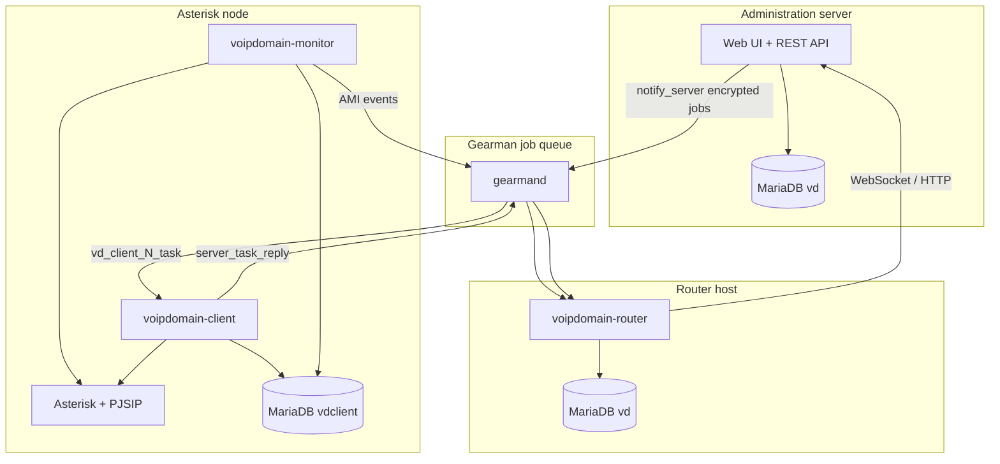

# VoIP Domain — Architecture

High-level architecture for developers and operators. Full detail: [DEVELOPER-MANUAL.md](DEVELOPER-MANUAL.md).

---

## 1. Three-tier model

VoIP Domain separates **configuration** (admin), **orchestration** (daemons), and **telephony execution** (Asterisk).

| Layer | Process | Database | Role |
|-------|---------|----------|------|
| Admin | NGiNX + PHP-FPM | `vd` | CRUD, reports, provisioning commands |
| Router | `voipdomain-router` | `vd` | Live channel/queue/peer state, notifications, command replay |
| Client | `voipdomain-client` | `vdclient` | Apply config to Asterisk, firmware, dialplan files |
| Monitor | `voipdomain-monitor` | `vdclient` | AMI listener, forward events to router |
| FastAGI | `voipdomain-fastagi` | Local data files | AGI applications (billing, LCR, etc.) |

**FastAGI data:** uses local JSON files in `datadir` (synchronized by the client daemon). No database connection required.

Asterisk nodes can operate **offline** for calls; the admin queues changes in `Commands` until the client reconnects.

---

## 2. Hook-based modularity

Every feature is a **PHP function** registered on a named **hook** or **filter**. Modules are discovered by scanning directories — no central registry file.

| Runtime | Module roots |
|---------|--------------|
| Admin UI/API | `Administrative Interface/modules/*`, `Administrative Interface/plugins/*` |
| Client daemon | `Daemons/client-modules/*` |
| Router daemon | `Daemons/router-modules/*` |
| Monitor daemon | `Daemons/monitor-modules/*` |
| FastAGI | `Daemons/fastagi-modules/*` |
| Custom plugins | `Plugins/*` (deployed to `plugins/` under webroot) |

---

## 3. Two communication paths

### 3.1 Configuration path (admin → client)

Used when an operator changes servers, extensions, queues, firmware, etc.

1. Admin API executes business logic and calls `notify_server($serverId, $event, $data)`.
2. Payload is encrypted (AES + RSA + HMAC) and sent via Gearman `vd_client_{id}_task`.
3. Client `task_manager` decrypts and calls `framework_call($event, $data)`.
4. Client module writes Asterisk configs, reloads services, returns `{code, message}`.
5. Client sends `server_task_reply`; router removes row from `Commands`.

### 3.2 Real-time path (monitor → router)

Used for live channel state, queue members, peer registration — **no client daemon**.

1. Asterisk AMI emits event (e.g. `Newchannel`, `QueueMemberStatus`).
2. Monitor calls `framework_call($eventName, $eventArray)`.
3. Monitor module updates local cache and `$gm->doBackground("channels_create", ...)`.
4. Router hook updates in-memory `$_in["Channels"]`, `$_in["Queues"]`, `$_in["Peers"]`.
5. Notification rules may push to WebSocket subscribers (`pushpub`).

---

## 4. Multi-tenant

- Central database `vd` holds all tenants, users, servers, billing.
- Super-administrator (`Tenant = 0`) manages tenants via `/master` when hostname matches `masterhostname`.
- Regular users belong to a tenant; API queries filter by `$_in["session"]["Tenant"]`.
- Each tenant has isolated object trees (servers, ranges, extensions, etc.).

---

## 5. File system layout (RPM)

| Path | Content |
|------|---------|
| `/var/lib/voipdomain/webroot` | Admin PHP application (`nginx:nginx`) |
| `/var/lib/voipdomain/storage/` | Uploads — avatars, firmwares, sounds, … (`nginx:nginx`) |
| `/var/lib/voipdomain/data` | Node JSON cache (`asterisk:asterisk`, client package) |
| `/var/lib/voipdomain/daemons/` | Daemon PHP entry points + modules |
| `/etc/voipdomain/*.conf` | INI configuration |
| `/etc/asterisk/voipdomain/` | Bootstrap includes + generated configs |
| `/var/spool/voipdomain/file-transfer/` | VDFT staging |

---

## 6. Extension points summary

| Mechanism | Use for |
|-----------|---------|
| Hooks | API endpoints, pages, daemon events, IVR operators |
| Filters | Menus, object types, session data, optional UI slots |
| Plugins | Third-party features with DB + optional daemon modules |
| `notify_server` events | Push config changes to remote nodes |
| VDFT | Large binary transfers (audio, firmware, plugin tarballs) |

---

## 7. Related documents

- [DEPLOYMENT-PLANNING.md](DEPLOYMENT-PLANNING.md) — topology, databases, optional daemons, provisioning per site
- [DIALPLAN.md](DIALPLAN.md) — Asterisk dialplan bootstrap and plugin hooks
- [DEVELOPER-MANUAL.md](DEVELOPER-MANUAL.md) — hooks, plugins, API, daemons in full detail
- [INSTALL.md](INSTALL.md) — installation
- [../rpm/README.md](../rpm/README.md) — RPM packages
- [IMPLEMENTED-FEATURES.md](IMPLEMENTED-FEATURES.md) — recent platform features
