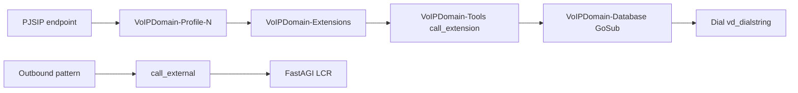

# VoIP Domain — Asterisk Dialplan & Bootstrap Configuration

How server-side Asterisk configuration is structured, generated via hooks, and
extended by plugins.

**Related:** [DEVELOPER-MANUAL.md](DEVELOPER-MANUAL.md) · [DEPLOYMENT-PLANNING.md](DEPLOYMENT-PLANNING.md)

Portuguese: [../pt_BR/DIALPLAN.md](../pt_BR/DIALPLAN.md)

---

## 1. Architecture overview

Starting with v1.1, all Asterisk bootstrap configuration files are **dynamically
generated** by the VoIP Domain client daemon using a hook-based pipeline. Static
bootstrap files are no longer shipped or manually edited. The daemon generates
them on startup, server rebuild, or plugin state changes.

| Layer | Location | Generated by |
|-------|----------|--------------|
| **Bootstrap** (hook-generated) | `/etc/asterisk/voipdomain/bootstrap/` | `asterisk_bootstrap_generate()` in the client daemon |
| **Generated** (per-entity) | `/etc/asterisk/voipdomain/configs/` | Admin CRUD → client daemon event handlers |

Phone keypad dialplan (auto-provision templates) is separate — see developer
manual §20 and `dialplan_generate` hooks in `ranges/client.php`.

---

## 2. Hook-based generation system

### 2.1 How it works

The generation system is defined in `Daemons/includes/bootstrap.inc.php`. It
maintains a registry of **sections**, each mapping to:
- An output file (e.g., `dialplan.conf`)
- An Asterisk reload command (e.g., `dialplan reload`)
- An ordered list of hook suffixes

When `asterisk_bootstrap_generate()` is called, for each section it:
1. Iterates each hook suffix in order
2. Calls the named hook (e.g., `asterisk_dialplan_globals`)
3. Each registered function receives the accumulated buffer and returns
   the modified buffer (pipeline pattern)
4. Writes the file only if content changed (compared without header)
5. Executes the section-specific reload command only for changed files

### 2.2 Registered sections

| Section | Output file | Reload command | Hook prefix |
|---------|-------------|----------------|-------------|
| `dialplan` | `dialplan.conf` | `dialplan reload` | `asterisk_dialplan_` |
| `pjsip` | `pjsip.conf` | `pjsip reload` | `asterisk_pjsip_` |
| `pjsip_notify` | `pjsip_notify.conf` | `pjsip reload` | `asterisk_pjsip_notify_` |
| `queues` | `queues.conf` | `module reload app_queue.so` | `asterisk_queues_` |
| `confbridge` | `confbridge.conf` | `module reload app_confbridge.so` | `asterisk_confbridge_` |
| `voicemail` | `voicemail.conf` | `voicemail reload` | `asterisk_voicemail_` |
| `moh` | `musiconhold.conf` | `moh reload` | `asterisk_moh_` |
| `manager` | `manager.conf` | `manager reload` | `asterisk_manager_` |
| `indications` | `indications.conf` | `module reload indications` | `asterisk_indications_` |

### 2.3 Dialplan hook order

The dialplan section has the richest hook list:

```
asterisk_dialplan_globals      → config globals, profiles, gateways
asterisk_dialplan_database     → [VoIPDomain-Database] context
asterisk_dialplan_extensions   → [VoIPDomain-Extensions] context
asterisk_dialplan_hints        → [VoIPDomain-Hints] context
asterisk_dialplan_exceptions   → [VoIPDomain-Exceptions] context
asterisk_dialplan_blocks       → [VoIPDomain-blocks] context
asterisk_dialplan_ranges       → [VoIPDomain-ranges] context
asterisk_dialplan_ivr          → IVR context includes
asterisk_dialplan_services     → [VoIPDomain-Services] context
asterisk_dialplan_routing      → Transhipment, Direct, public contexts
asterisk_dialplan_internal     → [VoIPDomain-Internal] context
asterisk_dialplan_tools        → [VoIPDomain-Tools] context
asterisk_dialplan_handlers     → handler contexts (pre-bridge, etc.)
asterisk_dialplan_extra        → plugin bootstrap fragment includes
```

### 2.4 Selective reload

Each section tracks its own reload command. Only Asterisk modules whose
configuration files actually changed get reloaded. For example:
- Dialplan changes → `dialplan reload`
- PJSIP changes → `pjsip reload`
- Queue changes → `module reload app_queue.so`

This avoids unnecessary call disruptions from a full `core reload`.

---

## 3. Asterisk main config includes

The `configure-asterisk.sh` script ensures that each Asterisk main config
file includes the hook-generated bootstrap:

| Asterisk conf | Include line |
|---------------|-------------|
| `extensions.conf` | `#include voipdomain/bootstrap/dialplan.conf` |
| `pjsip.conf` | `#include voipdomain/bootstrap/pjsip.conf` |
| `pjsip_notify.conf` | `#include voipdomain/bootstrap/pjsip_notify.conf` |
| `queues.conf` | `#include voipdomain/bootstrap/queues.conf` |
| `confbridge.conf` | `#include voipdomain/bootstrap/confbridge.conf` |
| `voicemail.conf` | `#include voipdomain/bootstrap/voicemail.conf` |
| `musiconhold.conf` | `#include voipdomain/bootstrap/musiconhold.conf` |
| `agents.conf` | `#include voipdomain/bootstrap/agents.conf` |
| `manager.conf` | `#include voipdomain/bootstrap/manager.conf` |
| `indications.conf` | `#include voipdomain/bootstrap/indications.conf` |

---

## 4. Call flow (simplified)



---

## 5. Extending configuration from plugins

### 5.1 Adding content to an existing section (append)

Register a function on any hook to append content:

```php
framework_add_hook ( "asterisk_dialplan_tools", "myplugin_dialplan_tools");

function myplugin_dialplan_tools ( $buffer, $parameters)
{
  $buffer .= "exten => my_feature,1,NoOp(My plugin feature)\n";
  $buffer .= " same => n,Return()\n\n";
  return $buffer;
}
```

### 5.2 Modifying existing content (search/replace)

Since each function receives the full buffer built by all prior functions,
plugins can modify any existing content:

```php
framework_add_hook ( "asterisk_dialplan_routing", "myplugin_modify_routing");

function myplugin_modify_routing ( $buffer, $parameters)
{
  // Inject a custom check before the standard denylist check
  $buffer = str_replace (
    "ExecIf(\${DB_EXISTS(denylist-",
    "GoSub(VoIPDomain-Tools,myplugin_check,1)\n same => n,ExecIf(\${DB_EXISTS(denylist-",
    $buffer
  );
  return $buffer;
}
```

### 5.3 Inserting before/after a specific function

Use `framework_add_hook_at` for precise positioning:

```php
framework_add_hook_at (
  "asterisk_dialplan_internal",
  "IN_HOOK_INSERT_BEFORE agent_dialplan_internal",
  "myplugin_pre_agent"
);
```

### 5.4 Generating a single section

When a module knows only its own section changed:

```php
asterisk_bootstrap_generate_section ( "dialplan");
```

### 5.5 Entity lifecycle hooks

Standard hooks (`extension_phone_add_post`, `gateway_add_post`, etc.) remain
the primary way to alter per-entity `.conf` files in the `configs/` directory.

### 5.6 Country / outbound rules

Copy the pattern in `profiles/country-*.php` and
`extensions-phones/country-*.php` — append to profile dialplan buffers or
phone `DialPlan` arrays.

---

## 6. Generation triggers

Bootstrap regeneration is triggered by:
- **Server rebuild** — the `server_rebuild_post` hook fires
  `bootstrap_regenerate_on_rebuild()` in `bootstrap/client.php`
- **Plugin install/remove** — the `plugin_state_change` hook fires
  `bootstrap_regenerate_on_plugin()`
- **Daemon startup** — the client daemon generates configuration on first
  boot if bootstrap files are missing

---

## 7. File structure

```
/etc/asterisk/
├── voipdomain/
│   ├── bootstrap/           ← Hook-generated (DO NOT EDIT MANUALLY)
│   │   ├── dialplan.conf
│   │   ├── pjsip.conf
│   │   ├── pjsip_notify.conf
│   │   ├── queues.conf
│   │   ├── confbridge.conf
│   │   ├── voicemail.conf
│   │   ├── musiconhold.conf
│   │   ├── manager.conf
│   │   └── indications.conf
│   └── configs/             ← Per-entity generated files
│       ├── dialplan-globals.conf
│       ├── dialplan-extension-*.conf
│       ├── sip-extension-*.conf
│       ├── queue-*.conf
│       ├── confbridge-*.conf
│       └── ...
├── extensions.conf          ← Includes bootstrap/dialplan.conf
├── pjsip.conf               ← Includes bootstrap/pjsip.conf
└── ...
```

---

## 8. Operational notes

- Bootstrap files have an auto-generated header with timestamp; changes below
  the header are compared to detect actual content changes.
- Empty globs require placeholder `*-000000.conf` stubs (shipped in RPM).
- `AGIADDR` in `dialplan-globals.conf` must match your FastAGI deployment
  ([DEPLOYMENT-PLANNING.md](DEPLOYMENT-PLANNING.md) §6).
- Manual edits to bootstrap files will be overwritten on next regeneration.
- To force regeneration: restart the client daemon or trigger a server rebuild.

---

*Document version: 2026-07 — VoIP Domain 1.1.*
