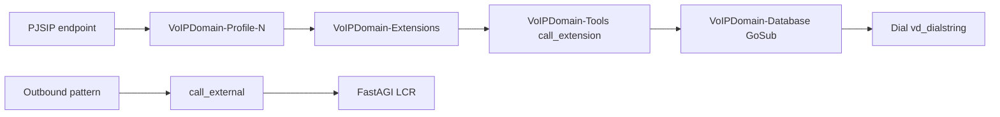

# VoIP Domain — Asterisk Dialplan

How server-side dialplan is structured, generated, and extended by plugins.

**Related:** [DEVELOPER-MANUAL.md](DEVELOPER-MANUAL.md) · [DEPLOYMENT-PLANNING.md](DEPLOYMENT-PLANNING.md)

Portuguese: [../pt_BR/DIALPLAN.md](../pt_BR/DIALPLAN.md)

---

## 1. Two dialplan layers

| Layer | Location | Changes when |
|-------|----------|--------------|
| **Bootstrap** (static) | `/etc/asterisk/voipdomain/bootstrap/` | RPM upgrade or manual edit |
| **Generated** (dynamic) | `/etc/asterisk/voipdomain/configs/` | Admin CRUD → client daemon |

Phone keypad dialplan (auto-provision templates) is separate — see developer manual §20 and `dialplan_generate` hooks in `ranges/client.php`.

---

## 2. Bootstrap include tree

`extensions.conf` includes `voipdomain/bootstrap/dialplan.conf`, which loads:

```
dialplan.conf                    ← manifest
├── dialplan-includes.conf       ← globals + generated fragment globs
├── dialplan-services.conf       ← [VoIPDomain-Services]
├── dialplan-routing.conf        ← Transhipment, Direct, public
├── dialplan-internal.conf       ← [VoIPDomain-Internal], agent login
├── dialplan-tools-core.conf     ← counter, get_digits, announce, …
├── dialplan-tools-calls.conf    ← call_extension, call_transfer, call_external
├── dialplan-tools-cdr.conf      ← call_cost, set_cdr, agents_password
├── dialplan-handlers.conf       ← handler-VoIPDomain-pre-bridge
└── configs/dialplan-bootstrap-*.conf  ← plugin fragments
```

Generated fragments (written by client modules):

| Glob | Module(s) |
|------|-----------|
| `dialplan-profile-*.conf` | `profiles/client.php`, `country-*.php` |
| `dialplan-extension-*.conf` | `extensions-phones`, hunt, queue, ivr |
| `dialplan-db-*.conf` | `write_config("configdb", …)` — GoSub variable stubs |
| `dialplan-gateway-*.conf` | `gateways/client.php` |
| `dialplan-ivr-*.conf` | `ivr/client.php` |
| `dialplan-block-*.conf`, `dialplan-exception-*.conf`, `dialplan-range-*.conf` | respective modules |

Context names used by PHP generators are mapped in `/etc/voipdomain/client.conf` `[contexts]` and must match bootstrap (e.g. `public = VoIPDomain-public`).

---

## 3. Call flow (simplified)



---

## 4. Extending dialplan from plugins

### 4.1 Bootstrap fragment (recommended)

Write a file included after core bootstrap:

```php
write_dialplan_plugin ( "myplugin", "[VoIPDomain-Tools]\n" .
  "exten => my_feature,1,NoOp(My plugin)\n same => n,Return()\n");
asterisk_exec ( "dialplan reload");
```

Remove with `unlink_dialplan_plugin ( "myplugin")`.

Regenerate on full rebuild by registering **`dialplan_bootstrap_regenerate`** (called from `server_rebuild_post` in `dialplan/client.php`).

### 4.2 Post-process generated fragments

Register hook **`dialplan_write_post`** — receives `type`, `filename`, `content`; return modified dialplan string before write.

### 4.3 Country / outbound rules

Copy the pattern in `profiles/country-*.php` and `extensions-phones/country-*.php` — append to profile dialplan buffers or phone `DialPlan` arrays.

### 4.4 Entity lifecycle hooks

Standard hooks (`extension_phone_add_post`, `gateway_add_post`, …) remain the primary way to alter per-entity `.conf` files.

---

## 5. Operational notes

- Empty globs require placeholder `*-000000.conf` stubs (shipped in RPM).
- After bootstrap file changes on installed nodes, run `asterisk -rx "dialplan reload"`.
- `AGIADDR` in `dialplan-globals.conf` must match your FastAGI deployment ([DEPLOYMENT-PLANNING.md](DEPLOYMENT-PLANNING.md) §6).

---

*Document version: 2026-06 — VoIP Domain 0.3 RC1.*
