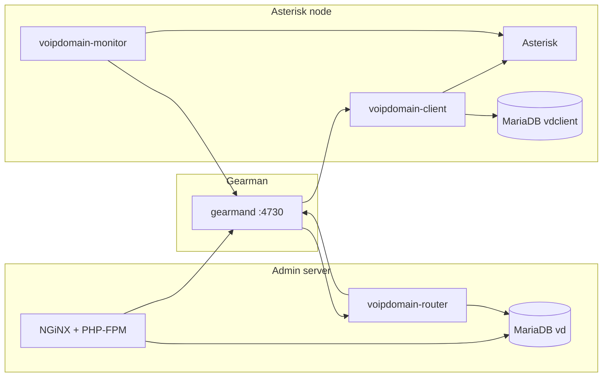

# VoIP Domain — Installation Guide

Step-by-step deployment for operators and system administrators. Brazilian Portuguese: [../pt_BR/INSTALL.md](../pt_BR/INSTALL.md).

**Documentation hub:** [../README.md](../README.md) · **Planning:** [DEPLOYMENT-PLANNING.md](DEPLOYMENT-PLANNING.md) · Architecture: [ARCHITECTURE.md](ARCHITECTURE.md) · Security: [SECURITY.md](SECURITY.md)

---

## 1. Deployment models

VoIP Domain is designed for **RHEL-family Linux** (RHEL, Rocky, AlmaLinux). Three common layouts:

| Model | Hosts | Use when |
|-------|-------|----------|
| **Split** | 1 admin server + 1+ Asterisk nodes | Production; scale telephony independently |
| **Admin-only lab** | 1 server (UI + router, no Asterisk) | Configuration testing without calls |
| **All-in-one** | 1 server (everything) | Lab, small PBX, proof of concept |



The admin UI does **not** need to run 24/7 for calls to work. Asterisk nodes queue billing and sync when the admin link returns.

---

## 2. Prerequisites by role

### 2.1 Administration server

| Component | Version / notes |
|-----------|-----------------|
| **OS** | RHEL 8/9 (or compatible); PHP 5.5+ required — avoid RHEL 7 default PHP 5.4 for production |
| **NGiNX** | [nginx.org](https://nginx.org/) |
| **MariaDB** | [mariadb.org](https://mariadb.org/) — database `vd` |
| **PHP-FPM** | 5.5+ with modules: PDO, SimpleXML, curl, dom, fileinfo, gd, **gearman**, gettext, hash, iconv, json, libxml, mbstring, mysql/mysqli, openssl, pcntl, pcre, session, sockets, xml, zip; **imagick** recommended |
| **PHP Gearman** | PECL [gearman](https://pecl.php.net/package/gearman) |
| **Gearman** | `gearmand` job server |
| **RPM packages** | `voipdomain-webserver`, `voipdomain-router`, `voipdomain-daemons-common` |

### 2.2 Asterisk node

| Component | Version / notes |
|-----------|-----------------|
| **Asterisk** | 21 or 22 (**22 LTS** recommended) |
| **MariaDB** | Local database `vdclient` (billing / plugins offline cache) |
| **PHP CLI** | Same extensions as daemons: gearman, mysqli, json, mbstring, pcntl, posix, sockets, curl, dom, SimpleXML, openssl, pcre; **proctitle** optional (RHEL 8+) |
| **Gearman** | `gearmand` (or reach admin’s Gearman over private network) |
| **RPM packages** | `voipdomain-daemons-common`, `voipdomain-client`, `voipdomain-fastagi`, `voipdomain-monitor` |

### 2.3 Daemons (router, client, monitor, fastagi)

| Daemon | Host | Purpose |
|--------|------|---------|
| `voipdomain-router` | Admin server (typical) | Routes Gearman events; WebSocket to UI |
| `voipdomain-client` | Each Asterisk node | Applies config; registers `vd_client_{id}_task` |
| `voipdomain-monitor` | Each Asterisk node | AMI → Gearman |
| `voipdomain-fastagi` | Each Asterisk node | FastAGI scripts |

**Standby nodes:** set `backup = true` in `/etc/voipdomain/client.conf` to also register `vd_backup_server_{id}_task`.

---

## 3. RPM installation (recommended)

Full package layout: [../rpm/README.md](../rpm/README.md).

### 3.1 Configure YUM/DNF repository

```bash
cp Documentations/rpm/VoIPDomain.repo /etc/yum.repos.d/
rpm --import https://rhel.voipdomain.io/azevedo@voipdomain.io.key
```

### 3.2 Administration server

```bash
dnf install mariadb-server gearmand \
  voipdomain-webserver voipdomain-router voipdomain-daemons-common

systemctl enable --now mariadb nginx php-fpm gearmand
systemctl enable --now voipdomain-router
systemctl enable --now voipdomain-daemon-reload@router.path

systemd-tmpfiles --create /usr/lib/tmpfiles.d/voipdomain.conf
systemd-tmpfiles --create /usr/lib/tmpfiles.d/voipdomain-webserver.conf
```

**Edit before going live:**

| File | Action |
|------|--------|
| `/etc/nginx/conf.d/voipdomain.conf` | Set `server_name`, SSL certificate paths |
| `/etc/voipdomain/webinterface.conf` | Gearman host, language, debug off in production |

NGiNX and PHP-FPM must share the socket `/run/php-fpm/voipdomain.sock` (shipped in RPM `%config` files). Details: [../etc/nginx/README.md](../etc/nginx/README.md).

Open the site in a browser and complete **Section 8** (web installer).

The RPM ships `/etc/voipdomain/webinterface.conf` with `installed = false` and **no** `[mysql]` section so the web installer runs on first access. If you upgraded from an older package and still have placeholder MySQL credentials, either complete **Section 8** after setting `installed = false` and removing the `[mysql]` block, or create the MariaDB user/database to match the config (Section 6).

### 3.3 Asterisk node

```bash
dnf install mariadb-server gearmand asterisk \
  voipdomain-daemons-common voipdomain-client \
  voipdomain-fastagi voipdomain-monitor

systemctl enable --now mariadb gearmand asterisk
systemctl enable --now voipdomain-client voipdomain-fastagi voipdomain-monitor
systemctl enable --now voipdomain-daemon-reload@{client,fastagi,monitor}.path

systemd-tmpfiles --create /usr/lib/tmpfiles.d/voipdomain.conf
systemd-tmpfiles --create /usr/lib/tmpfiles.d/voipdomain-client.conf
```

Configure Asterisk bootstrap includes (Section 9), then run the node provisioning script with the **Server ID** from the admin UI:

```bash
/etc/asterisk/voipdomain/configure-asterisk.sh <SERVER_ID>
```

Alternatively download the install script from **Servers → Install script** in the admin UI.

Point `/etc/voipdomain/client.conf` (and monitor/fastagi configs) at the admin Gearman host if Gearman is not local.

### 3.4 Build RPMs from source

```bash
chmod +x Documentations/rpm/build-rpm.sh
Documentations/rpm/build-rpm.sh 0.3
```

Output: `~/rpmbuild/RPMS/noarch/`. Install the subpackages matching each host role.

---

## 4. Manual / development installation

Use when not installing from RPM (git checkout, custom paths).

1. Clone or copy the repository.
2. **Webroot:** point NGiNX `root` to `Administrative Interface/` (or copy to `/var/lib/voipdomain/webroot`).
3. Copy sample configs from `Documentations/etc/`:
   - `nginx/voipdomain.conf` → `/etc/nginx/conf.d/`
   - `nginx/voipdomain-fastcgi.conf` → `/etc/nginx/`
   - `php-fpm.d/voipdomain.conf` → `/etc/php-fpm.d/`
   - Create storage tree: `install -d -o nginx -g nginx /var/lib/voipdomain/storage/{avatars,captures,firmwares,recordings,sounds}`
   - `install -d -m 0770 -o root -g nginx /etc/voipdomain`
   - `voipdomain/webinterface.conf` → `/etc/voipdomain/`
4. Install `Documentations/systemd/voipdomain-*.service` and `voipdomain-daemon-reload@.{path,service}` to `/usr/lib/systemd/system/`.
5. Install tmpfiles (role-specific):
   - All hosts: `Documentations/systemd/voipdomain-tmpfiles.conf` → `/usr/lib/tmpfiles.d/voipdomain.conf`
   - Admin / web: `Documentations/systemd/voipdomain-webserver-tmpfiles.conf` → `/usr/lib/tmpfiles.d/voipdomain-webserver.conf`
   - Asterisk node: `Documentations/systemd/voipdomain-client-tmpfiles.conf` → `/usr/lib/tmpfiles.d/voipdomain-client.conf`
   Run `systemd-tmpfiles --create` on each file installed on that host.
6. Symlink or copy `Daemons/` to `/var/lib/voipdomain/daemons/` (RPM uses this path; units call `php …/client.php` etc.).
7. **Asterisk nodes:** `install -d -m 0750 -o asterisk -g asterisk /var/lib/voipdomain/data` (JSON cache for client/FastAGI).
8. Ensure `gearmand`, MariaDB, NGiNX, PHP-FPM, and Asterisk (on nodes) are installed and running.
9. On dev/all-in-one without path units, reload daemons manually after code changes:

```bash
systemctl reload voipdomain-client.service   # on nodes
systemctl reload voipdomain-router.service   # on admin
```

---

## 5. NGiNX and PHP-FPM

The admin UI runs as **`nginx`** (PHP-FPM pool user). NGiNX serves static files and forwards PHP to the dedicated pool.

| Repository file | Install path |
|-----------------|--------------|
| `Documentations/etc/nginx/voipdomain.conf` | `/etc/nginx/conf.d/voipdomain.conf` |
| `Documentations/etc/nginx/voipdomain-fastcgi.conf` | `/etc/nginx/voipdomain-fastcgi.conf` |
| `Documentations/etc/php-fpm.d/voipdomain.conf` | `/etc/php-fpm.d/voipdomain.conf` |

Full NGiNX main-config reference (not installed as `%config`): `Documentations/etc/nginx/nginx.conf`. See [../etc/nginx/README.md](../etc/nginx/README.md).

Both vhost and pool must use:

```ini
listen = /run/php-fpm/voipdomain.sock
```

After RPM install, verify ownership on the **administration server** (`voipdomain-webserver` installed):

```bash
ls -la /etc/voipdomain/
# expected:
# drwxrwx--- root nginx  .
# -rw-rw---- root nginx  webinterface.conf
# -rw------- root root   router.conf

ls -ld /var/lib/voipdomain/webroot /var/lib/voipdomain/storage
# expected: nginx nginx
```

The `voipdomain-webserver` package creates `/etc/voipdomain` as `root:nginx` mode `0770` and `webinterface.conf` as `0660` (`rw-rw----`) so PHP-FPM (user `nginx`, group `nginx`) can read and write during the web installer. Mode `0640` is **not** enough: group only gets read. Daemon configs (`router.conf`, etc.) stay `0600 root:root`.

If you upgraded from an older RPM and permissions are wrong:

```bash
sudo chown root:nginx /etc/voipdomain
sudo chmod 0770 /etc/voipdomain
sudo chown root:nginx /etc/voipdomain/webinterface.conf
sudo chmod 0660 /etc/voipdomain/webinterface.conf
sudo systemctl reload php-fpm
```

Or reinstall/upgrade `voipdomain-webserver` ≥ 0.3-7 (the `%posttrans` scriptlet applies the same fix).

**SELinux (Fedora / RHEL with Enforcing):** POSIX mode `0770` and `root:nginx` are not enough if PHP-FPM (`httpd_t`) is denied write access to `etc_t`. Symptoms: installer reports “cannot write to /etc/voipdomain” while `ls -la` looks correct.

```bash
getenforce
ls -Z /etc/voipdomain
id nginx
sudo -u nginx test -w /etc/voipdomain && echo writable || echo denied
sudo ausearch -m avc -ts recent 2>/dev/null | grep voipdomain
```

Fix (requires `policycoreutils-python-utils` for `semanage`):

```bash
sudo semanage fcontext -a -t httpd_sys_rw_content_t '/etc/voipdomain' 2>/dev/null || \
sudo semanage fcontext -m -t httpd_sys_rw_content_t '/etc/voipdomain'
sudo semanage fcontext -a -t httpd_sys_rw_content_t '/etc/voipdomain/webinterface.conf' 2>/dev/null || \
sudo semanage fcontext -m -t httpd_sys_rw_content_t '/etc/voipdomain/webinterface.conf'
sudo semanage fcontext -a -t httpd_sys_rw_content_t '/etc/voipdomain/master-certificate.key'
sudo restorecon -Rv /etc/voipdomain
sudo -u nginx test -w /etc/voipdomain && echo OK
```

`voipdomain-webserver` ≥ 0.3-12 runs the same `semanage`/`restorecon` steps in `%post` when SELinux is Enforcing. `router.conf` is not relabeled (stays `etc_t` for the router daemon).

**MariaDB over TCP (installer or runtime):** PHP-FPM (`httpd_t`) cannot connect to `mysqld_port_t` (TCP 3306) unless allowed. AVC: `denied { name_connect } … dest=3306`. On the same host, prefer hostname **`localhost`** (Unix socket) instead of `127.0.0.1` (TCP). The RPM does **not** change SELinux booleans; enable TCP only if you need it:

```bash
sudo setsebool -P httpd_can_network_connect_db 1
sudo ausearch -m avc -ts recent 2>/dev/null | grep mysqld_port
```

That boolean is system-wide for all `httpd_t` processes — use only when MariaDB is remote or you must use TCP. Co-located installs should use `localhost` in the web installer and in `[mysql]` `hostname`.

If `id nginx` does not list group `nginx`, reload PHP-FPM after fixing the pool `group = nginx` in `/etc/php-fpm.d/voipdomain.conf`.

Test and reload:

```bash
nginx -t && systemctl reload nginx
systemctl restart php-fpm
```

The web installer checks that `/etc/voipdomain` exists and is writable by the PHP-FPM user (`nginx` on RPM layouts).

---

## 6. MariaDB

**Admin server:** the web installer creates database `vd`, user `vd`@`localhost`, and schema.

**Asterisk node:** the client daemon and plugins use local database `vdclient`. Create it during node setup (provisioning script or admin “install script”).

Plugin packages with `install.php` / `update.php` / `uninstall.php` apply to central `vd` and are mirrored to each node’s `vdclient` via the `plugin_db_apply` Gearman event.

---

## 7. Gearman

Run `gearmand` on the admin server and on each node **or** use a single Gearman reachable privately from all hosts.

Default port: **4730**. Restrict with firewall to admin ↔ node traffic only. See [SECURITY.md](SECURITY.md).

Verify:

```bash
gearadmin --server=127.0.0.1:4730 --status
```

---

## 8. Web installer (admin server)

After NGiNX serves the Administrative Interface:

1. **Permission check** — `/etc/voipdomain` writable by PHP-FPM user; no existing `webinterface.conf` on fresh install (installer may create it).
2. **Database** — provide MariaDB host, admin credentials; installer creates `vd` and `vd` user.
3. **Super-admin** — default login `admin` / `admin`. **Change immediately.**

The installer creates `/etc/voipdomain/master-certificate.key` used to encrypt Gearman payloads.

---

## 9. Asterisk bootstrap

Install Asterisk 21/22, then include VoIP Domain bootstrap files in each Asterisk config:

| File | Include line |
|------|----------------|
| `agents.conf` | `#include voipdomain/bootstrap/agents.conf` |
| `extensions.conf` | `#include voipdomain/bootstrap/dialplan.conf` |
| `musiconhold.conf` | `#include voipdomain/bootstrap/musiconhold.conf` |
| `pjsip.conf` | `#include voipdomain/bootstrap/pjsip.conf` |
| `pjsip_notify.conf` | `#include voipdomain/bootstrap/pjsip_notify.conf` |
| `queues.conf` | `#include voipdomain/bootstrap/queues.conf` |
| `voicemail.conf` | `#include voipdomain/bootstrap/voicemail.conf` |

Or run:

```bash
Documentations/etc/asterisk/configure-asterisk.sh <SERVER_ID>
# RPM path: /etc/asterisk/voipdomain/configure-asterisk.sh
```

Reload Asterisk after changes: `asterisk -rx "core reload"`.

---

## 10. All-in-one server

Install all RPM subpackages (or combine manual steps) on one host.

**File ownership:** PHP-FPM runs as `nginx`; daemons may run as `nobody` or `asterisk`. The router reads cryptographic keys from the database after starting as root, then drops privileges to `nobody`.


Enable all path units:

```bash
systemctl enable --now voipdomain-daemon-reload@{router,client,monitor,fastagi}.path
```

---

## 11. Post-install configuration (tenant)

In the multi-tenant admin UI, create a tenant and minimum object tree:

1. Server (register each Asterisk node)
2. Gateway (dummy allowed for lab)
3. Profile
4. Cost center
5. Group
6. Range
7. Extension

Then place test calls and verify CDR/reports.

---

## 12. Verification checklist

| Check | Command / action |
|-------|------------------|
| Web UI loads | HTTPS to admin vhost |
| Gearman workers | `gearadmin --status` shows `vd_client_*` on nodes |
| Router running | `systemctl status voipdomain-router` |
| Client connected | Admin UI → Servers → node status online |
| Asterisk dialplan | `asterisk -rx "dialplan show"` includes VoIP Domain contexts |
| Daemon reload | Touch trigger or `systemctl reload voipdomain-client` after plugin deploy |
| Debug (lab only) | `GET /debug/ping`, `GET /debug/api/map` with `general.debug = true` |

---

## 13. Troubleshooting

| Symptom | Likely cause | Fix |
|---------|--------------|-----|
| Installer permission error | POSIX owner/mode or SELinux | Section 5: `chown`/`chmod`; if `0770 root:nginx` already OK, run SELinux `semanage`/`restorecon` block |
| PHP 503 / blank page / favicon 500 | `webinterface.conf` not readable by PHP-FPM | `chown root:nginx webinterface.conf`; `chmod 0660`; reload php-fpm |
| Styled error page missing (raw 500/404) | PHP fatal before `error_5xx()` (often MySQL on PHP 8+) | Upgrade webroot package; fix DB creds or run web installer (Section 8) |
| PHP Fatal: Failed opening config.inc.php | `open_basedir`, SELinux, or dir not traversable | `sudo -u nginx test -r …/config.inc.php`; update pool `open_basedir` to `/var/lib/voipdomain/`; `restorecon -RF webroot` |
| NGiNX default 404 on `GET /` (favicon shows app 503) | Old vhost: `index index.php` + `try_files $uri/` → blocked `/index.php` | Update vhost: `try_files $uri @vdmodules;`, remove `index index.php`; `nginx -t && systemctl reload nginx` |
| MySQL connection fails (install or login) | SELinux blocks TCP to MariaDB | Use `localhost` (socket) not `127.0.0.1`; or `setsebool -P httpd_can_network_connect_db 1` (Section 5) |
| MySQL Access denied for `vd`@`localhost` | Sample config or wrong DB password | Run web installer, or `mysql` as root and create user/db (Section 6) |
| 502 Bad Gateway | PHP-FPM socket mismatch | Align `voipdomain.sock` in NGiNX and pool |
| Node offline in UI | Gearman unreachable or wrong server ID | Check `gearmand`, firewall :4730, `client.conf` |
| Config not applied | Client worker not registered | Restart `voipdomain-client`; verify `vd_client_{id}_task` |
| Plugin DB missing on node | `plugin_db_apply` failed | Re-enable plugin; check client logs |
| Router cannot decrypt jobs | Missing ACL on master key | Section 10 `setfacl` |

Logs: `journalctl -u voipdomain-client -f` (and `-router`, `-monitor`, `-fastagi`).

---

## See also

| Topic | Document |
|-------|----------|
| RPM details | [../rpm/README.md](../rpm/README.md) |
| Security hardening | [SECURITY.md](SECURITY.md) |
| Testing in lab | [TESTING-METHODOLOGY.md](TESTING-METHODOLOGY.md) |
| Recent platform features | [IMPLEMENTED-FEATURES.md](IMPLEMENTED-FEATURES.md) |
| Developer reference | [DEVELOPER-MANUAL.md](DEVELOPER-MANUAL.md) |
