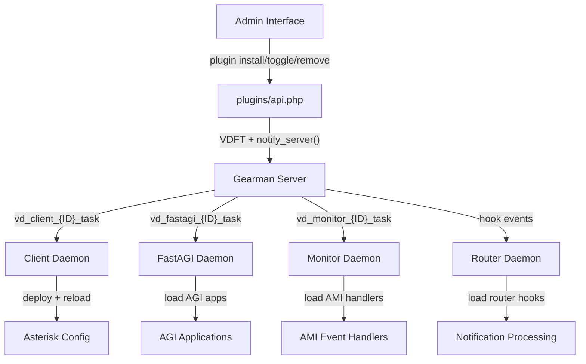

<!-- 7b29fce0-a5b2-4f30-b84e-1d11660ff114 -->
---
todos:
  - id: "manifest"
    content: "Phase 1: Create plugin.json manifest format, validation, backward-compat parsing, migrate existing plugins"
    status: pending
  - id: "fix-version"
    content: "Phase 2.1: Fix Version column (float to varchar), update comparison logic"
    status: pending
  - id: "fix-router-sighup"
    content: "Phase 2.2: Fix router SIGHUP to restart when new modules detected"
    status: pending
  - id: "state-machine"
    content: "Phase 2.3: Add plugin state machine (S=Syncing, F=Failed) with recovery"
    status: pending
  - id: "dependency-enforcement"
    content: "Phase 2.4: Add dependency enforcement on disable/remove (409 Conflict)"
    status: pending
  - id: "rollback"
    content: "Phase 2.5: Add rollback logic for partial installs"
    status: pending
  - id: "fastagi-gearman"
    content: "Phase 3: Add Gearman worker to FastAGI daemon with plugin deploy/remove/config handlers"
    status: pending
  - id: "monitor-gearman"
    content: "Phase 4: Add Gearman worker to Monitor daemon with plugin deploy/remove/config handlers"
    status: pending
  - id: "config-distribution"
    content: "Phase 5: Plugin config sync, bootstrap regen after deploy, multi-daemon targeting"
    status: pending
  - id: "documentation"
    content: "Phase 6: Write PLUGINS.md (EN + PT_BR), update DEVELOPER-MANUAL, CHANGELOG/README/RELEASES"
    status: pending
isProject: false
---
# Plugin System Full Overhaul

## Current Architecture Problems

The plugin system has a single choke point: only the client daemon can receive and process plugin operations. FastAGI and Monitor are blind to plugin lifecycle. The router has a SIGHUP handler bug that prevents loading new modules. There is no declarative metadata format, no state machine, and no dependency enforcement.

## Target Architecture



## Phase 1: Plugin Manifest (`plugin.json`)

Create a declarative manifest format that replaces the `.cfg` INI file:

```json
{
  "name": "sampleitems",
  "version": "1.0.0",
  "author": "Ernani Azevedo",
  "description": "Sample plugin demonstrating the plugin system",
  "license": "GPLv3",
  "requires": {
    "core": ">=1.0",
    "php": ">=8.1"
  },
  "conflicts": [],
  "daemons": ["client", "fastagi"],
  "hooks": {
    "install": "sampleitems_install",
    "uninstall": "sampleitems_uninstall",
    "enable": "sampleitems_enable",
    "disable": "sampleitems_disable",
    "upgrade": "sampleitems_upgrade"
  },
  "config": {
    "schema": "config-schema.json"
  }
}
```

**Files to create/modify:**
- Create validation function `plugin_validate_manifest()` in [Administrative Interface/includes/plugin-install.inc.php](Administrative Interface/includes/plugin-install.inc.php)
- Modify `plugins_import()` in config/api.php to parse `plugin.json` (with `.cfg` backward compat)
- Create `plugin.json` for existing plugins (`sampleitems`, `users-avatar`, `tellows-score`)

## Phase 2: Fix Core Bugs

### 2.1 Version column (float to varchar)

In [Administrative Interface/modules/interface/install.php](Administrative Interface/modules/interface/install.php):
- Change `Version float unsigned` to `Version varchar(32)`
- Add migration in update.php for existing installs
- Update all comparison logic to use `version_compare()` instead of numeric comparison

### 2.2 Router SIGHUP bug

In [Daemons/router.php](Daemons/router.php):
- The custom `router_systemd_reload_handler()` at ~line 309 overrides the generic exit handler
- Fix: detect if new modules exist on disk (compare loaded vs available); if yes, `exit(0)` for full restart; if no, do in-process cache reload

### 2.3 Plugin state machine

Alter `Plugins.Status` from `enum('A','I')` to `enum('A','I','S','F')`:
- `A` = Active
- `I` = Inactive/Disabled
- `S` = Syncing (installation/upgrade in progress)
- `F` = Failed (partial install, needs recovery)

Add recovery function `plugin_recover_failed()` that retries sync for `F`-state plugins.

### 2.4 Dependency enforcement on disable/remove

In `plugins_toggle()` and `plugins_remove()`:
- Query all active plugins' `Requires` field
- Parse dependencies and check if the target plugin is required by any other
- Return HTTP 409 Conflict if dependency would break

### 2.5 Rollback on partial install

In `plugin_apply_installation()`:
- Wrap the entire operation in a state machine: set `Status = 'S'` before starting
- On success: set `Status = 'A'`
- On failure: set `Status = 'F'`, log the failure point, leave files in place for retry

## Phase 3: FastAGI Gearman Worker

In [Daemons/fastagi.php](Daemons/fastagi.php):

- Add `require_once` for `plugin-install.inc.php` and `file-transfer.inc.php`
- Create a Gearman worker thread/process alongside the TCP socket listener
- Register task function `vd_fastagi_{ServerID}_task` (same envelope pattern as client)
- Handle events: `plugin_daemon_module_deploy`, `plugin_daemon_module_remove`, `plugin_db_apply`, `daemon_reload`
- The Gearman worker runs in a forked child process or via `stream_select()` multiplexing with the AGI socket

Implementation approach: Use non-blocking Gearman via `GearmanWorker::addOptions(GEARMAN_WORKER_NON_BLOCKING)` and multiplex with the existing `stream_select()` loop that handles AGI connections.

Create [Daemons/fastagi-modules/plugins/fastagi.php](Daemons/fastagi-modules/plugins/fastagi.php) with:
- `plugin_daemon_module_deploy` handler (same as client's)
- `plugin_daemon_module_remove` handler
- `file_transfer_begin/chunk/commit` handlers

## Phase 4: Monitor Gearman Worker

In [Daemons/monitor.php](Daemons/monitor.php):

- Add `require_once` for `plugin-install.inc.php` and `file-transfer.inc.php`
- Create a Gearman worker alongside the AMI connection
- Register task function `vd_monitor_{ServerID}_task`
- Handle same events as FastAGI
- Multiplex with `stream_select()` on both AMI socket and Gearman worker

Create [Daemons/monitor-modules/plugins/monitor.php](Daemons/monitor-modules/plugins/monitor.php) with the same handlers.

## Phase 5: Configuration Distribution

### 5.1 Plugin config sync

Plugins can declare configuration that needs to reach specific daemons via `plugin.json`:
```json
"config": {
  "schema": "config-schema.json",
  "targets": ["client", "fastagi", "monitor"]
}
```

When plugin config is changed via the admin UI:
1. Serialize config to JSON
2. Send via `notify_server()` to all affected daemons with event `plugin_config_update`
3. Each daemon stores in its local data directory and fires `plugin_{name}_config_changed` hook

### 5.2 Bootstrap regeneration after plugin deploy

In the client daemon's `plugin_daemon_module_deploy` handler:
- After extracting and reloading, fire `plugin_state_change` hook
- This triggers `asterisk_bootstrap_generate()` (already wired in bootstrap/client.php)

### 5.3 Notify server targeting

Modify `notify_server()` and `plugin_sync_daemon_modules_remote()` to support targeting specific daemon types per server. Currently it sends to `vd_client_{ID}_task` — it needs to also send to `vd_fastagi_{ID}_task` and `vd_monitor_{ID}_task` when those module types are present.

## Phase 6: Documentation

Create [Documentations/en/PLUGINS.md](Documentations/en/PLUGINS.md) and [Documentations/pt_BR/PLUGINS.md](Documentations/pt_BR/PLUGINS.md) covering:
- Plugin manifest format (`plugin.json` specification)
- Directory structure standard
- Lifecycle (install, enable, disable, remove, upgrade)
- Hook registration patterns
- Daemon module types and when to use each
- Configuration distribution
- Bootstrap/dialplan extension from plugins
- PJSIP extension from plugins
- Security considerations
- Example: creating a complete plugin from scratch

Update CHANGELOG, README, RELEASES per documentation directives.
