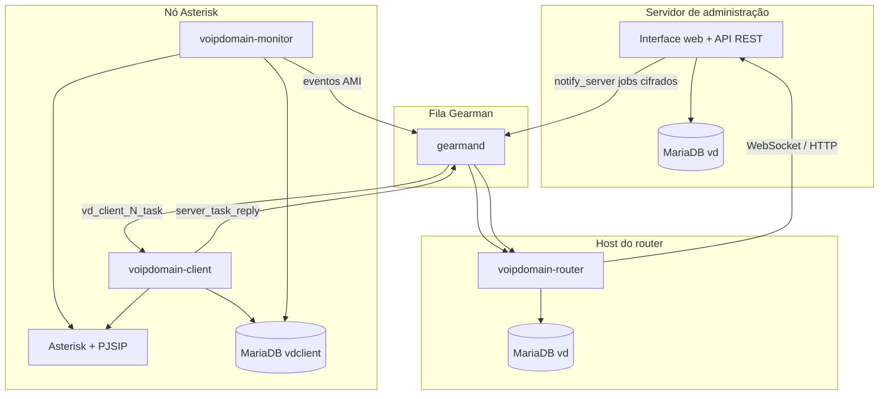

# VoIP Domain — Arquitetura

Visão geral para desenvolvedores e operadores. Detalhes completos: [MANUAL-DO-DESENVOLVEDOR.md](MANUAL-DO-DESENVOLVEDOR.md).

---

## 1. Modelo em três camadas

O VoIP Domain separa **configuração** (admin), **orquestração** (daemons) e **execução telefônica** (Asterisk).

| Camada | Processo | Base de dados | Função |
|--------|----------|---------------|--------|
| Admin | NGiNX + PHP-FPM | `vd` | CRUD, relatórios, comandos de provisionamento |
| Router | `voipdomain-router` | `vd` | Estado ao vivo de canais/filas/peer, notificações, replay de comandos |
| Client | `voipdomain-client` | `vdclient` | Aplicar config no Asterisk, firmware, ficheiros de dialplan |
| Monitor | `voipdomain-monitor` | `vdclient` | Listener AMI, encaminhar eventos ao router |
| FastAGI | `voipdomain-fastagi` | Arquivos locais | Aplicações AGI (bilhetagem, LCR, etc.) |

**Dados FastAGI:** usa arquivos JSON locais em `datadir` (sincronizados pelo daemon client). Não requer conexão com banco de dados.

Nós Asterisk podem operar **offline** para chamadas; o admin enfileira alterações em `Commands` até o client reconectar.

---

## 2. Modularidade baseada em hooks

Cada funcionalidade é uma **função PHP** registada num **hook** ou **filter**. Módulos são descobertos por varredura de diretórios — não há ficheiro central de registo.

| Runtime | Raízes de módulos |
|---------|-------------------|
| Admin UI/API | `Administrative Interface/modules/*`, `plugins/*` |
| Client daemon | `Daemons/client-modules/*` |
| Router daemon | `Daemons/router-modules/*` |
| Monitor daemon | `Daemons/monitor-modules/*` |
| FastAGI | `Daemons/fastagi-modules/*` |
| Plugins customizados | `Plugins/*` (implantados em `plugins/` no webroot) |

---

## 3. Dois caminhos de comunicação

### 3.1 Caminho de configuração (admin → client)

Quando um operador altera servidores, extensões, filas, firmware, etc.

1. A API admin executa a lógica e chama `notify_server($serverId, $event, $data)`.
2. O payload é cifrado (AES + RSA + HMAC) e enviado via Gearman `vd_client_{id}_task`.
3. O `task_manager` do client decifra e chama `framework_call($event, $data)`.
4. O módulo client escreve configs Asterisk, recarrega serviços, devolve `{code, message}`.
5. O client envia `server_task_reply`; o router remove a linha em `Commands`.

### 3.2 Caminho em tempo real (monitor → router)

Estado ao vivo de canais, filas, registo de peers — **sem client daemon**.

1. AMI do Asterisk emite evento (ex.: `Newchannel`, `QueueMemberStatus`).
2. Monitor chama `framework_call($eventName, $eventArray)`.
3. Módulo monitor actualiza cache local e `$gm->doBackground("channels_create", ...)`.
4. Hook do router actualiza `$_in["Channels"]`, `$_in["Queues"]`, `$_in["Peers"]` em memória.
5. Regras de notificação podem enviar para subscritores WebSocket (`pushpub`).

---

## 4. Multi-tenant

- Base central `vd` contém todos os tenants, utilizadores, servidores, bilhetagem.
- Super-administrador (`Tenant = 0`) gere tenants via `/master` quando o hostname coincide com `masterhostname`.
- Utilizadores normais pertencem a um tenant; queries API filtram por `$_in["session"]["Tenant"]`.

---

## 5. Layout de ficheiros (RPM)

| Caminho | Conteúdo |
|---------|----------|
| `/var/lib/voipdomain/webroot` | Aplicação PHP admin |
| `/var/lib/voipdomain/daemons/` | Entry points + módulos daemon |
| `/etc/voipdomain/*.conf` | Configuração INI |
| `/etc/asterisk/voipdomain/` | Bootstrap includes + configs geradas |
| `/var/lib/voipdomain/storage/` | Avatares, firmware, sons, gravações |
| `/var/spool/voipdomain/file-transfer/` | Staging VDFT |

---

## 6. Resumo dos pontos de extensão

| Mecanismo | Usar para |
|-----------|-----------|
| Hooks | Endpoints API, páginas, eventos daemon, operadores IVR |
| Filters | Menus, tipos de objecto, dados de sessão, slots UI opcionais |
| Plugins | Funcionalidades de terceiros com BD + módulos daemon |
| Eventos `notify_server` | Enviar alterações de config a nós remotos |
| VDFT | Transferências binárias grandes (áudio, firmware, tarballs de plugin) |

---

## 7. Documentos relacionados

- [MANUAL-DO-DESENVOLVEDOR.md](MANUAL-DO-DESENVOLVEDOR.md)
- [INSTALL.md](INSTALL.md)
- [../rpm/README.md](../rpm/README.md)
- [RECURSOS-IMPLEMENTADOS.md](RECURSOS-IMPLEMENTADOS.md)
