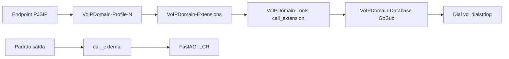

# VoIP Domain — Dialplan & Configuração Bootstrap do Asterisk

Como a configuração do Asterisk no lado do servidor é estruturada, gerada via
hooks e estendida por plugins.

**Relacionado:** [MANUAL-DO-DESENVOLVEDOR.md](MANUAL-DO-DESENVOLVEDOR.md) · [PLANEJAMENTO-DE-IMPLANTACAO.md](PLANEJAMENTO-DE-IMPLANTACAO.md)

English: [../en/DIALPLAN.md](../en/DIALPLAN.md)

---

## 1. Visão geral da arquitetura

A partir da v1.1, todos os arquivos de configuração bootstrap do Asterisk são
**gerados dinamicamente** pelo daemon cliente do VoIP Domain usando um pipeline
baseado em hooks. Arquivos bootstrap estáticos não são mais distribuídos ou
editados manualmente. O daemon os gera na inicialização, reconstrução do
servidor ou alterações no estado de plugins.

| Camada | Localização | Gerado por |
|--------|-------------|------------|
| **Bootstrap** (gerado por hooks) | `/etc/asterisk/voipdomain/bootstrap/` | `asterisk_bootstrap_generate()` no daemon cliente |
| **Gerado** (por entidade) | `/etc/asterisk/voipdomain/configs/` | CRUD Admin → handlers do daemon cliente |

O dialplan do teclado do telefone (templates de auto-provisionamento) é
separado — veja o manual do desenvolvedor §20 e os hooks `dialplan_generate`
em `ranges/client.php`.

---

## 2. Sistema de geração baseado em hooks

### 2.1 Como funciona

O sistema de geração é definido em `Daemons/includes/bootstrap.inc.php`. Ele
mantém um registro de **seções**, cada uma mapeando para:
- Um arquivo de saída (ex: `dialplan.conf`)
- Um comando de reload do Asterisk (ex: `dialplan reload`)
- Uma lista ordenada de sufixos de hooks

Quando `asterisk_bootstrap_generate()` é chamado, para cada seção:
1. Itera cada sufixo de hook na ordem
2. Chama o hook nomeado (ex: `asterisk_dialplan_globals`)
3. Cada função registrada recebe o buffer acumulado e retorna o buffer
   modificado (padrão pipeline)
4. Grava o arquivo somente se o conteúdo mudou (comparado sem o cabeçalho)
5. Executa o comando de reload específico da seção apenas para arquivos alterados

### 2.2 Seções registradas

| Seção | Arquivo de saída | Comando de reload | Prefixo do hook |
|-------|-----------------|-------------------|-----------------|
| `dialplan` | `dialplan.conf` | `dialplan reload` | `asterisk_dialplan_` |
| `pjsip` | `pjsip.conf` | `pjsip reload` | `asterisk_pjsip_` |
| `pjsip_notify` | `pjsip_notify.conf` | `pjsip reload` | `asterisk_pjsip_notify_` |
| `queues` | `queues.conf` | `module reload app_queue.so` | `asterisk_queues_` |
| `confbridge` | `confbridge.conf` | `module reload app_confbridge.so` | `asterisk_confbridge_` |
| `voicemail` | `voicemail.conf` | `voicemail reload` | `asterisk_voicemail_` |
| `moh` | `musiconhold.conf` | `moh reload` | `asterisk_moh_` |
| `manager` | `manager.conf` | `manager reload` | `asterisk_manager_` |
| `indications` | `indications.conf` | `module reload indications` | `asterisk_indications_` |

### 2.3 Ordem dos hooks do dialplan

A seção dialplan possui a lista mais rica de hooks:

```
asterisk_dialplan_globals      → globals de configuração, perfis, gateways
asterisk_dialplan_database     → contexto [VoIPDomain-Database]
asterisk_dialplan_extensions   → contexto [VoIPDomain-Extensions]
asterisk_dialplan_hints        → contexto [VoIPDomain-Hints]
asterisk_dialplan_exceptions   → contexto [VoIPDomain-Exceptions]
asterisk_dialplan_blocks       → contexto [VoIPDomain-blocks]
asterisk_dialplan_ranges       → contexto [VoIPDomain-ranges]
asterisk_dialplan_ivr          → includes de contexto IVR
asterisk_dialplan_services     → contexto [VoIPDomain-Services]
asterisk_dialplan_routing      → contextos Transhipment, Direct, public
asterisk_dialplan_internal     → contexto [VoIPDomain-Internal]
asterisk_dialplan_tools        → contexto [VoIPDomain-Tools]
asterisk_dialplan_handlers     → contextos de handlers (pre-bridge, etc.)
asterisk_dialplan_extra        → includes de fragmentos bootstrap de plugins
```

### 2.4 Reload seletivo

Cada seção rastreia seu próprio comando de reload. Apenas módulos do Asterisk
cujos arquivos de configuração realmente mudaram são recarregados. Por exemplo:
- Alterações no dialplan → `dialplan reload`
- Alterações no PJSIP → `pjsip reload`
- Alterações nas filas → `module reload app_queue.so`

Isso evita interrupções desnecessárias de chamadas causadas por um `core reload`
completo.

---

## 3. Includes nos arquivos principais do Asterisk

O script `configure-asterisk.sh` garante que cada arquivo de configuração
principal do Asterisk inclua o bootstrap gerado por hooks:

| Conf do Asterisk | Linha de include |
|------------------|-----------------|
| `extensions.conf` | `#include voipdomain/bootstrap/dialplan.conf` |
| `pjsip.conf` | `#include voipdomain/bootstrap/pjsip.conf` |
| `pjsip_notify.conf` | `#include voipdomain/bootstrap/pjsip_notify.conf` |
| `queues.conf` | `#include voipdomain/bootstrap/queues.conf` |
| `confbridge.conf` | `#include voipdomain/bootstrap/confbridge.conf` |
| `voicemail.conf` | `#include voipdomain/bootstrap/voicemail.conf` |
| `musiconhold.conf` | `#include voipdomain/bootstrap/musiconhold.conf` |
| `agents.conf` | `#include voipdomain/bootstrap/agents.conf` |
| `manager.conf` | `#include voipdomain/bootstrap/manager.conf` |
| `indications.conf` | `#include voipdomain/bootstrap/indications.conf` |

---

## 4. Fluxo de chamada (simplificado)



---

## 5. Estendendo configuração a partir de plugins

### 5.1 Adicionando conteúdo a uma seção existente (append)

Registre uma função em qualquer hook para adicionar conteúdo:

```php
framework_add_hook ( "asterisk_dialplan_tools", "meuplugin_dialplan_tools");

function meuplugin_dialplan_tools ( $buffer, $parameters)
{
  $buffer .= "exten => meu_recurso,1,NoOp(Recurso do meu plugin)\n";
  $buffer .= " same => n,Return()\n\n";
  return $buffer;
}
```

### 5.2 Modificando conteúdo existente (busca/substituição)

Como cada função recebe o buffer completo construído por todas as funções
anteriores, plugins podem modificar qualquer conteúdo existente:

```php
framework_add_hook ( "asterisk_dialplan_routing", "meuplugin_modificar_routing");

function meuplugin_modificar_routing ( $buffer, $parameters)
{
  // Injeta uma verificação customizada antes do check padrão de denylist
  $buffer = str_replace (
    "ExecIf(\${DB_EXISTS(denylist-",
    "GoSub(VoIPDomain-Tools,meuplugin_check,1)\n same => n,ExecIf(\${DB_EXISTS(denylist-",
    $buffer
  );
  return $buffer;
}
```

### 5.3 Inserindo antes/depois de uma função específica

Use `framework_add_hook_at` para posicionamento preciso:

```php
framework_add_hook_at (
  "asterisk_dialplan_internal",
  "IN_HOOK_INSERT_BEFORE agent_dialplan_internal",
  "meuplugin_pre_agent"
);
```

### 5.4 Gerando uma única seção

Quando um módulo sabe que apenas sua seção mudou:

```php
asterisk_bootstrap_generate_section ( "dialplan");
```

### 5.5 Hooks de ciclo de vida de entidades

Hooks padrão (`extension_phone_add_post`, `gateway_add_post`, etc.) continuam
sendo a forma principal de alterar arquivos `.conf` por entidade no diretório
`configs/`.

### 5.6 Regras de país / saída

Copie o padrão em `profiles/country-*.php` e
`extensions-phones/country-*.php` — adicione aos buffers de dialplan de perfil
ou arrays `DialPlan` do telefone.

---

## 6. Gatilhos de geração

A regeneração do bootstrap é disparada por:
- **Reconstrução do servidor** — o hook `server_rebuild_post` dispara
  `bootstrap_regenerate_on_rebuild()` em `bootstrap/client.php`
- **Instalação/remoção de plugin** — o hook `plugin_state_change` dispara
  `bootstrap_regenerate_on_plugin()`
- **Inicialização do daemon** — o daemon cliente gera a configuração na
  primeira execução se os arquivos bootstrap estiverem ausentes

---

## 7. Estrutura de arquivos

```
/etc/asterisk/
├── voipdomain/
│   ├── bootstrap/           ← Gerado por hooks (NÃO EDITE MANUALMENTE)
│   │   ├── dialplan.conf
│   │   ├── pjsip.conf
│   │   ├── pjsip_notify.conf
│   │   ├── queues.conf
│   │   ├── confbridge.conf
│   │   ├── voicemail.conf
│   │   ├── musiconhold.conf
│   │   ├── manager.conf
│   │   └── indications.conf
│   └── configs/             ← Arquivos gerados por entidade
│       ├── dialplan-globals.conf
│       ├── dialplan-extension-*.conf
│       ├── sip-extension-*.conf
│       ├── queue-*.conf
│       ├── confbridge-*.conf
│       └── ...
├── extensions.conf          ← Inclui bootstrap/dialplan.conf
├── pjsip.conf               ← Inclui bootstrap/pjsip.conf
└── ...
```

---

## 8. Notas operacionais

- Arquivos bootstrap possuem cabeçalho auto-gerado com timestamp; alterações
  abaixo do cabeçalho são comparadas para detectar mudanças reais.
- Globs vazios requerem stubs placeholder `*-000000.conf` (distribuídos no RPM).
- `AGIADDR` em `dialplan-globals.conf` deve corresponder ao seu deployment
  FastAGI ([PLANEJAMENTO-DE-IMPLANTACAO.md](PLANEJAMENTO-DE-IMPLANTACAO.md) §6).
- Edições manuais nos arquivos bootstrap serão sobrescritas na próxima
  regeneração.
- Para forçar regeneração: reinicie o daemon cliente ou dispare uma
  reconstrução do servidor.

---

*Versão do documento: 2026-07 — VoIP Domain 1.1.*
