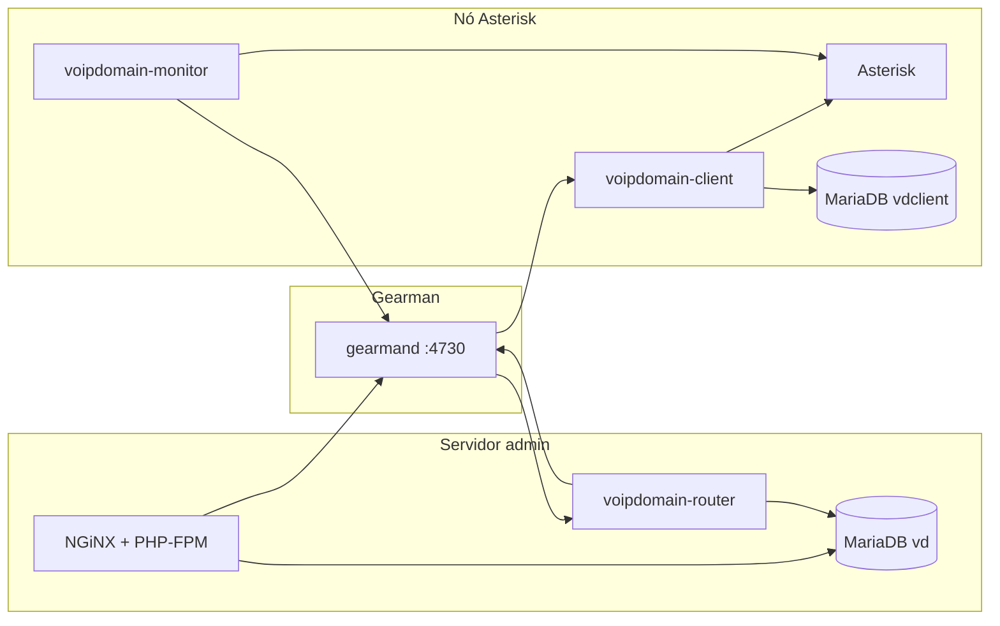

# VoIP Domain — Guia de Instalação

Implantação passo a passo para operadores e administradores de sistema. English: [../en/INSTALL.md](../en/INSTALL.md).

**Hub de documentação:** [README.md](README.md) · **Planejamento:** [PLANEJAMENTO-DE-IMPLANTACAO.md](PLANEJAMENTO-DE-IMPLANTACAO.md) · Arquitetura: [ARQUITETURA.md](ARQUITETURA.md) · Segurança: [SEGURANCA.md](SEGURANCA.md)

---

## 1. Modelos de implantação

O VoIP Domain foi desenvolvido para **Linux da família RHEL** (RHEL, Rocky, AlmaLinux). Três layouts comuns:

| Modelo | Hosts | Quando usar |
|--------|-------|-------------|
| **Separado** | 1 servidor admin + 1+ nós Asterisk | Produção; escalar telefonia de forma independente |
| **Só admin (lab)** | 1 servidor (UI + router, sem Asterisk) | Testar configuração sem chamadas |
| **All-in-one** | 1 servidor (tudo) | Lab, PBX pequeno, prova de conceito |



A interface admin **não** precisa ficar 24/7 online para chamadas funcionarem. Nós Asterisk enfileiram billing e sincronizam quando o link com o admin volta.

---

## 2. Pré-requisitos por função

### 2.1 Servidor de administração

| Componente | Versão / observações |
|------------|----------------------|
| **SO** | RHEL 8/9 (ou compatível); PHP 5.5+ — evite PHP 5.4 padrão do RHEL 7 em produção |
| **NGiNX** | [nginx.org](https://nginx.org/) |
| **MariaDB** | [mariadb.org](https://mariadb.org/) — banco `vd` |
| **PHP-FPM** | 5.5+ com módulos: PDO, SimpleXML, curl, dom, fileinfo, gd, **gearman**, gettext, hash, iconv, json, libxml, mbstring, mysql/mysqli, openssl, pcntl, pcre, session, sockets, xml, zip; **imagick** recomendado |
| **PHP Gearman** | PECL [gearman](https://pecl.php.net/package/gearman) |
| **Gearman** | `gearmand` |
| **Pacotes RPM** | `voipdomain-webserver`, `voipdomain-router`, `voipdomain-daemons-common` |

### 2.2 Nó Asterisk

| Componente | Versão / observações |
|------------|----------------------|
| **Asterisk** | 21 ou 22 (**22 LTS** recomendado) |
| **MariaDB** | Banco local `vdclient` (cache offline de billing / plugins) |
| **PHP CLI** | Mesmas extensões dos daemons: gearman, mysqli, json, mbstring, pcntl, posix, sockets, curl, dom, SimpleXML, openssl, pcre; **proctitle** opcional (RHEL 8+) |
| **Gearman** | `gearmand` local ou Gearman do admin em rede privada |
| **Pacotes RPM** | `voipdomain-daemons-common`, `voipdomain-client`, `voipdomain-fastagi`, `voipdomain-monitor` |

### 2.3 Daemons (router, client, monitor, fastagi)

| Daemon | Host | Função |
|--------|------|--------|
| `voipdomain-router` | Servidor admin (típico) | Roteia eventos Gearman; WebSocket para UI |
| `voipdomain-client` | Cada nó Asterisk | Aplica config; registra `vd_client_{id}_task` |
| `voipdomain-monitor` | Cada nó Asterisk | AMI → Gearman |
| `voipdomain-fastagi` | Cada nó Asterisk | Scripts FastAGI |

**Nós standby:** defina `backup = true` em `/etc/voipdomain/client.conf` para registrar também `vd_backup_server_{id}_task`.

---

## 3. Instalação via RPM (recomendado)

Layout completo dos pacotes: [../rpm/README.md](../rpm/README.md).

### 3.1 Configurar repositório YUM/DNF

```bash
cp Documentations/rpm/VoIPDomain.repo /etc/yum.repos.d/
rpm --import https://rhel.voipdomain.io/azevedo@voipdomain.io.key
```

### 3.2 Servidor de administração

```bash
dnf install mariadb-server gearmand \
  voipdomain-webserver voipdomain-router voipdomain-daemons-common

systemctl enable --now mariadb nginx php-fpm gearmand
systemctl enable --now voipdomain-router
systemctl enable --now voipdomain-daemon-reload@router.path

systemd-tmpfiles --create /usr/lib/tmpfiles.d/voipdomain.conf
systemd-tmpfiles --create /usr/lib/tmpfiles.d/voipdomain-webserver.conf
```

**Edite antes de produção:**

| Arquivo | Ação |
|---------|------|
| `/etc/nginx/conf.d/voipdomain.conf` | `server_name`, caminhos SSL |
| `/etc/voipdomain/webinterface.conf` | Host Gearman, idioma, debug desligado em produção |

NGiNX e PHP-FPM devem usar o socket `/run/php-fpm/voipdomain.sock` (arquivos `%config` do RPM). Detalhes: [../etc/nginx/README.md](../etc/nginx/README.md).

Abra o site no navegador e conclua a **Seção 8** (instalador web).

O RPM entrega `/etc/voipdomain/webinterface.conf` com `installed = false` e **sem** secção `[mysql]`, para o instalador web correr no primeiro acesso. Se fez upgrade de pacote antigo e ainda tem credenciais MySQL de exemplo, conclua a **Seção 8** após `installed = false` e remoção do bloco `[mysql]`, ou crie utilizador/base MariaDB conforme o config (Secção 6).

### 3.3 Nó Asterisk

```bash
dnf install mariadb-server gearmand asterisk \
  voipdomain-daemons-common voipdomain-client \
  voipdomain-fastagi voipdomain-monitor

systemctl enable --now mariadb gearmand asterisk
systemctl enable --now voipdomain-client voipdomain-fastagi voipdomain-monitor
systemctl enable --now voipdomain-daemon-reload@{client,fastagi,monitor}.path

systemd-tmpfiles --create /usr/lib/tmpfiles.d/voipdomain.conf
systemd-tmpfiles --create /usr/lib/tmpfiles.d/voipdomain-client.conf
```

Configure includes bootstrap do Asterisk (Seção 9), depois execute o script de provisionamento com o **ID do servidor** da UI admin:

```bash
/etc/asterisk/voipdomain/configure-asterisk.sh <SERVER_ID>
```

Ou baixe o script em **Servidores → Script de instalação** na interface admin.

Aponte `/etc/voipdomain/client.conf` (e configs monitor/fastagi) ao host Gearman do admin se o Gearman não for local.

### 3.4 Compilar RPMs a partir do código

```bash
chmod +x Documentations/rpm/build-rpm.sh
Documentations/rpm/build-rpm.sh 0.3
```

Saída: `~/rpmbuild/RPMS/noarch/`. Instale os subpacotes conforme a função de cada host.

---

## 4. Instalação manual / desenvolvimento

Quando não usar RPM (checkout git, paths customizados).

1. Clone ou copie o repositório.
2. **Webroot:** aponte o `root` do NGiNX para `Administrative Interface/` (ou copie para `/var/lib/voipdomain/webroot`).
3. Copie configs de exemplo de `Documentations/etc/`:
   - `nginx/voipdomain.conf` → `/etc/nginx/conf.d/`
   - `nginx/voipdomain-fastcgi.conf` → `/etc/nginx/`
   - `php-fpm.d/voipdomain.conf` → `/etc/php-fpm.d/`
   - Criar árvore storage: `install -d -o nginx -g nginx /var/lib/voipdomain/storage/{avatars,captures,firmwares,recordings,sounds}`
   - `install -d -m 0770 -o root -g nginx /etc/voipdomain`
   - `voipdomain/webinterface.conf` → `/etc/voipdomain/`
4. Instale `Documentations/systemd/voipdomain-*.service` e `voipdomain-daemon-reload@.{path,service}` em `/usr/lib/systemd/system/`.
5. Instale tmpfiles (conforme o papel do host):
   - Todos: `Documentations/systemd/voipdomain-tmpfiles.conf` → `/usr/lib/tmpfiles.d/voipdomain.conf`
   - Admin / web: `Documentations/systemd/voipdomain-webserver-tmpfiles.conf` → `/usr/lib/tmpfiles.d/voipdomain-webserver.conf`
   - Nó Asterisk: `Documentations/systemd/voipdomain-client-tmpfiles.conf` → `/usr/lib/tmpfiles.d/voipdomain-client.conf`
   Execute `systemd-tmpfiles --create` em cada ficheiro instalado nesse host.
6. Symlink ou copie `Daemons/` para `/var/lib/voipdomain/daemons/`.
7. **Nós Asterisk:** `install -d -m 0750 -o asterisk -g asterisk /var/lib/voipdomain/data` (cache JSON do client/FastAGI).
8. Garanta `gearmand`, MariaDB, NGiNX, PHP-FPM e Asterisk (nos nós) instalados e ativos.
9. Em dev/all-in-one sem path units, recarregue daemons manualmente após mudanças:

```bash
systemctl reload voipdomain-client.service   # nos nós
systemctl reload voipdomain-router.service   # no admin
```

---

## 5. NGiNX e PHP-FPM

| Arquivo no repositório | Caminho no servidor |
|------------------------|---------------------|
| `Documentations/etc/nginx/voipdomain.conf` | `/etc/nginx/conf.d/voipdomain.conf` |
| `Documentations/etc/nginx/voipdomain-fastcgi.conf` | `/etc/nginx/voipdomain-fastcgi.conf` |
| `Documentations/etc/php-fpm.d/voipdomain.conf` | `/etc/php-fpm.d/voipdomain.conf` |

Referência `nginx.conf` completo: `Documentations/etc/nginx/nginx.conf`. Ver [../etc/nginx/README.md](../etc/nginx/README.md).

Vhost e pool devem usar:

```ini
listen = /run/php-fpm/voipdomain.sock
```

Após RPM, verifique permissões no **servidor de administração** (com `voipdomain-webserver`):

```bash
ls -la /etc/voipdomain/
# esperado:
# drwxrwx--- root nginx  .
# -rw-rw---- root nginx  webinterface.conf
# -rw------- root root   router.conf

ls -ld /var/lib/voipdomain/webroot /var/lib/voipdomain/storage
# esperado: nginx nginx
```

O pacote `voipdomain-webserver` cria `/etc/voipdomain` como `root:nginx` modo `0770` e `webinterface.conf` como `0660` (`rw-rw----`), para o PHP-FPM (usuário `nginx`, grupo `nginx`) ler e gravar durante o instalador web. Modo `0640` **não** basta: o grupo só tem leitura. Configs de daemon (`router.conf`, etc.) permanecem `0600 root:root`.

Se fez upgrade de RPM antigo e as permissões estão erradas:

```bash
sudo chown root:nginx /etc/voipdomain
sudo chmod 0770 /etc/voipdomain
sudo chown root:nginx /etc/voipdomain/webinterface.conf
sudo chmod 0660 /etc/voipdomain/webinterface.conf
sudo systemctl reload php-fpm
```

Ou reinstale/atualize `voipdomain-webserver` ≥ 0.3-7 (o `%posttrans` aplica a mesma correção).

**SELinux (Fedora / RHEL em Enforcing):** modo `0770` e `root:nginx` não bastam se o PHP-FPM (`httpd_t`) não pode gravar em contexto `etc_t`. Sintoma: instalador diz que não consegue gravar em `/etc/voipdomain` com `ls -la` aparentemente correto.

```bash
getenforce
ls -Z /etc/voipdomain
id nginx
sudo -u nginx test -w /etc/voipdomain && echo gravável || echo negado
sudo ausearch -m avc -ts recent 2>/dev/null | grep voipdomain
```

Correção (requer `policycoreutils-python-utils` para `semanage`):

```bash
sudo semanage fcontext -a -t httpd_sys_rw_content_t '/etc/voipdomain' 2>/dev/null || \
sudo semanage fcontext -m -t httpd_sys_rw_content_t '/etc/voipdomain'
sudo semanage fcontext -a -t httpd_sys_rw_content_t '/etc/voipdomain/webinterface.conf' 2>/dev/null || \
sudo semanage fcontext -m -t httpd_sys_rw_content_t '/etc/voipdomain/webinterface.conf'
sudo semanage fcontext -a -t httpd_sys_rw_content_t '/etc/voipdomain/master-certificate.key'
sudo restorecon -Rv /etc/voipdomain
sudo -u nginx test -w /etc/voipdomain && echo OK
```

`voipdomain-webserver` ≥ 0.3-12 executa os mesmos passos `semanage`/`restorecon` no `%post` com SELinux Enforcing. `router.conf` não é relabelado (permanece `etc_t` para o daemon router).

**MariaDB via TCP (instalador ou runtime):** PHP-FPM (`httpd_t`) não pode ligar a `mysqld_port_t` (TCP 3306) sem permissão. AVC: `denied { name_connect } … dest=3306`. No mesmo host, prefira **`localhost`** (socket Unix) em vez de `127.0.0.1` (TCP). O RPM **não** altera booleans SELinux; active TCP só se precisar:

```bash
sudo setsebool -P httpd_can_network_connect_db 1
sudo ausearch -m avc -ts recent 2>/dev/null | grep mysqld_port
```

Esse boolean é global para processos `httpd_t` — use apenas com MariaDB remoto ou quando TCP for obrigatório. Instalações no mesmo host devem usar `localhost` no instalador web e em `[mysql]` `hostname`.

Se `id nginx` não listar o grupo `nginx`, recarregue o PHP-FPM após `group = nginx` em `/etc/php-fpm.d/voipdomain.conf`.

Teste e recarregue:

```bash
nginx -t && systemctl reload nginx
systemctl restart php-fpm
```

O instalador web verifica se `/etc/voipdomain` existe e é gravável pelo usuário PHP-FPM (`nginx` nos layouts RPM).

---

## 6. MariaDB

**Servidor admin:** o instalador web cria banco `vd`, usuário `vd`@`localhost` e schema.

**Nó Asterisk:** daemon client e plugins usam banco local `vdclient`. Crie-o na configuração do nó (script de provisionamento ou “install script” do admin).

Plugins com `install.php` / `update.php` / `uninstall.php` aplicam no `vd` central e espelham no `vdclient` de cada nó via evento Gearman `plugin_db_apply`.

---

## 7. Gearman

Execute `gearmand` no servidor admin e em cada nó **ou** use um único Gearman acessível em rede privada por todos os hosts.

Porta padrão: **4730**. Restrinja com firewall ao tráfego admin ↔ nós. Veja [SEGURANCA.md](SEGURANCA.md).

Verificação:

```bash
gearadmin --server=127.0.0.1:4730 --status
```

---

## 8. Instalador web (servidor admin)

Com o NGiNX servindo a Administrative Interface:

1. **Verificação de permissões** — `/etc/voipdomain` gravável pelo PHP-FPM; sem `webinterface.conf` existente em instalação nova.
2. **Banco de dados** — informe host MariaDB e credenciais admin; instalador cria `vd` e usuário `vd`.
3. **Super-admin** — login padrão `admin` / `admin`. **Altere imediatamente.**

O instalador cria `/etc/voipdomain/master-certificate.key` para criptografar payloads Gearman.

---

## 9. Bootstrap do Asterisk

Instale Asterisk 21/22 e inclua arquivos bootstrap VoIP Domain:

| Arquivo | Linha de include |
|---------|------------------|
| `agents.conf` | `#include voipdomain/bootstrap/agents.conf` |
| `extensions.conf` | `#include voipdomain/bootstrap/dialplan.conf` |
| `musiconhold.conf` | `#include voipdomain/bootstrap/musiconhold.conf` |
| `pjsip.conf` | `#include voipdomain/bootstrap/pjsip.conf` |
| `pjsip_notify.conf` | `#include voipdomain/bootstrap/pjsip_notify.conf` |
| `queues.conf` | `#include voipdomain/bootstrap/queues.conf` |
| `voicemail.conf` | `#include voipdomain/bootstrap/voicemail.conf` |

Ou execute:

```bash
Documentations/etc/asterisk/configure-asterisk.sh <SERVER_ID>
# Caminho RPM: /etc/asterisk/voipdomain/configure-asterisk.sh
```

Recarregue o Asterisk: `asterisk -rx "core reload"`.

---

## 10. Servidor all-in-one

Instale todos os subpacotes RPM (ou combine passos manuais) em um host.

**Donos de arquivos:** PHP-FPM roda como `nginx`; daemons podem rodar como `nobody` ou `asterisk`. O router lê chaves criptográficas do banco de dados após iniciar como root, depois dropa privilégios para `nobody`.


Habilite todas as path units:

```bash
systemctl enable --now voipdomain-daemon-reload@{router,client,monitor,fastagi}.path
```

---

## 11. Configuração pós-instalação (tenant)

Na UI multi-tenant, crie um tenant e a árvore mínima de objetos:

1. Servidor (registre cada nó Asterisk)
2. Gateway (dummy permitido em lab)
3. Perfil
4. Centro de custo
5. Grupo
6. Faixa (range)
7. Ramal (extension)

Depois faça chamadas de teste e verifique CDR/relatórios.

---

## 12. Checklist de verificação

| Verificação | Comando / ação |
|-------------|----------------|
| UI carrega | HTTPS no vhost admin |
| Workers Gearman | `gearadmin --status` mostra `vd_client_*` nos nós |
| Router ativo | `systemctl status voipdomain-router` |
| Nó online | UI admin → Servidores → status online |
| Dialplan Asterisk | `asterisk -rx "dialplan show"` inclui contextos VoIP Domain |
| Reload daemon | Touch no trigger ou `systemctl reload voipdomain-client` após deploy de plugin |
| Debug (só lab) | `GET /debug/ping`, `GET /debug/api/map` com `general.debug = true` |

---

## 13. Solução de problemas

| Sintoma | Causa provável | Correção |
|---------|----------------|----------|
| Erro de permissão no instalador | POSIX ou SELinux | Seção 5: `chown`/`chmod`; se já estiver `0770 root:nginx`, bloco SELinux `semanage`/`restorecon` |
| PHP 503 / página em branco / favicon 500 | `webinterface.conf` ilegível pelo PHP-FPM | `chown root:nginx webinterface.conf`; `chmod 0660`; reload php-fpm |
| Página de erro estilizada ausente (500/404 cru) | Fatal PHP antes de `error_5xx()` (MySQL no PHP 8+) | Atualize webroot; corrija DB ou use instalador web (Secção 8) |
| PHP Fatal: Failed opening config.inc.php | `open_basedir`, SELinux ou dir sem traverse | `sudo -u nginx test -r …/config.inc.php`; pool `open_basedir` → `/var/lib/voipdomain/`; `restorecon -RF webroot` |
| NGiNX 404 padrão em `GET /` (favicon mostra 503 da app) | Vhost antigo: `index index.php` + `try_files $uri/` bloqueia `/index.php` | Vhost: `try_files $uri @vdmodules;`, sem `index index.php`; `nginx -t && systemctl reload nginx` |
| Falha ligação MySQL (instalação ou login) | SELinux bloqueia TCP ao MariaDB | Use `localhost` (socket), não `127.0.0.1`; ou `setsebool -P httpd_can_network_connect_db 1` (Secção 5) |
| MySQL Access denied for `vd`@`localhost` | Config de exemplo ou password errada | Instalador web, ou `mysql` como root e crie user/BD (Secção 6) |
| 502 Bad Gateway | Socket PHP-FPM divergente | Alinhar `voipdomain.sock` no NGiNX e pool |
| Nó offline na UI | Gearman inacessível ou server ID errado | Verificar `gearmand`, firewall :4730, `client.conf` |
| Config não aplicada | Worker client não registrado | Reiniciar `voipdomain-client`; verificar `vd_client_{id}_task` |
| Banco de plugin ausente no nó | `plugin_db_apply` falhou | Reabilitar plugin; ver logs do client |
| Router não descriptografa jobs | ACL ausente na chave master | Seção 10 `setfacl` |

Logs: `journalctl -u voipdomain-client -f` (e `-router`, `-monitor`, `-fastagi`).

---

## Veja também

| Tópico | Documento |
|--------|-----------|
| Detalhes RPM | [../rpm/README.md](../rpm/README.md) |
| Endurecimento de segurança | [SEGURANCA.md](SEGURANCA.md) |
| Testes em lab | [METODOLOGIA-DE-TESTES.md](METODOLOGIA-DE-TESTES.md) |
| Recursos recentes | [RECURSOS-IMPLEMENTADOS.md](RECURSOS-IMPLEMENTADOS.md) |
| Referência para desenvolvedores | [MANUAL-DO-DESENVOLVEDOR.md](MANUAL-DO-DESENVOLVEDOR.md) |
